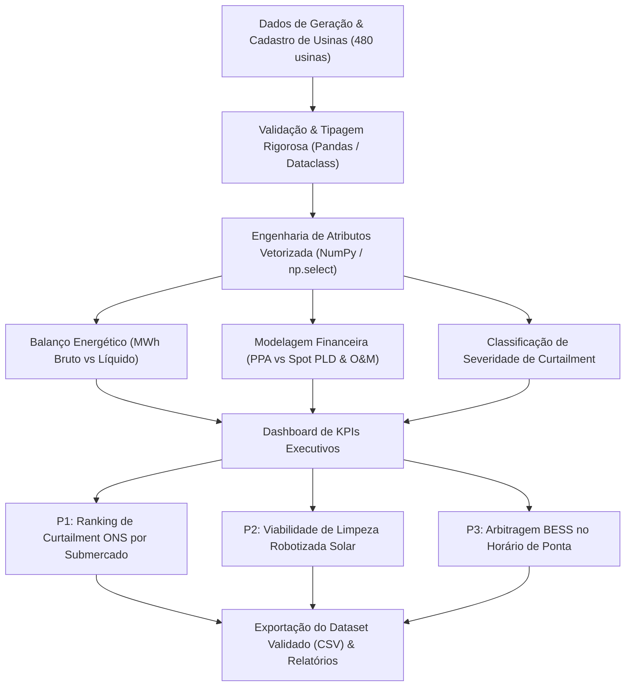

# ⚡ VoltGrid Analytics — Otimização de Geração Renovável, Mitigação de Curtailment & Arbitragem BESS

[](https://www.python.org/)
[](https://pandas.pydata.org/)
[](https://numpy.org/)
[](https://pytest.org/)
[](#)
[](https://peps.python.org/pep-0008/)
[](LICENSE)

---

## 📌 1. Visão Geral Executiva & Contexto de Negócio

No setor elétrico brasileiro, a expansão acelerada de usinas solares fotovoltaicas (UFV) e parques eólicos onshore (EOL) gerou gargalos de escoamento e estabilidade no Sistema Interligado Nacional (SIN).
Como resultado direto da saturação nas linhas de transmissão interestaduais de 500 kV/230 kV, o **Operador Nacional do Sistema Elétrico (ONS)** impõe cortes operacionais de despacho forçados (*curtailment*), impedindo usinas de injetar energia limpa na rede.

A **VoltGrid EnergyTech** opera e monitora uma carteira comissionada de **480 usinas geradoras** com **24.458,4 MW de capacidade instalada**. Este projeto implementa um pipeline de dados analítico e financeiro para:
1. **Quantificar perdas técnicas e regulatórias:** Identificar as perdas por *curtailment* ONS e perdas térmico-óticas por sujidade fotovoltaica (*soiling loss*);
2. **Avaliar a viabilidade de Capex/Opex:** Modelar a adoção de limpeza robotizada a seco para recuperação de eficiência fotovoltaica;
3. **Modelar arbitragem com Baterias BESS (*Battery Energy Storage Systems*):** Simular o armazenamento da energia cortada e seu despacho em horários de ponta com base no Preço de Liquidação das Diferenças (PLD) da CCEE.

---

## 📊 2. Indicadores-Chave de Desempenho (KPIs Consolidados)

A tabela abaixo sintetiza o balanço de energia e o impacto financeiro consolidado gerado pelo pipeline analítico:

| Indicador Estratégico | Valor Consolidado | Unidade / Referência |
| :--- | :---: | :--- |
| **Total de Usinas Monitoradas** | **480** | Usinas (Solar UFV & Eólica EOL) |
| **Capacidade Instalada Total** | **24.458,4** | MW (Megawatts) |
| **Geração Teórica Bruta** | **84.004.896,8** | MWh/ano |
| **Geração Líquida Realizada** | **77.395.360,5** | MWh/ano |
| **Fator de Capacidade Médio Real** | **36,12%** | Ponderado pela carteira |
| **Taxa Média de Curtailment ONS** | **4,05%** | Benchmark regulatório ONS: $\le 3,0\%$ |
| **Perda Financeira por Curtailment** | **R$ 616.993.981,00** | Avaliada ao PPA de R$ 185,00/MWh |
| **Perda Financeira por Sujidade (Soiling)** | **R$ 305.874.282,50** | Exclusiva para Solar Fotovoltaica |
| **Receita Bruta Realizada** | **R$ 14.318.141.692,50** | Venda em PPA |
| **EBITDA Operacional Consolidado** | **R$ 13.144.138.492,50** | Margem EBITDA de **91,8%** |

---

## 💡 3. Respostas às 3 Perguntas Críticas de Negócio

### 🎯 Pergunta 1: Qual região e fonte energética concentram o maior corte de geração forçada (curtailment) pelo ONS?

**Diagnóstico Quantitativo (Top 5 Submercados):**
1. **Nordeste / Bahia — Eólica Onshore (EOL):** 1.134.725,7 MWh cortados (**R$ 209,92 Milhões** | **34,02%** de todo o corte nacional);
2. **Nordeste / Rio Grande do Norte — Eólica Onshore (EOL):** 672.964,6 MWh cortados (**R$ 124,50 Milhões** | **20,18%** do corte nacional);
3. **Nordeste / Bahia — Solar Fotovoltaica (UFV):** 607.186,4 MWh cortados (**R$ 112,33 Milhões** | **18,21%** do corte nacional);
4. **Nordeste / Rio Grande do Norte — Solar Fotovoltaica (UFV):** 439.095,7 MWh cortados (**R$ 81,23 Milhões** | **13,17%** do corte nacional);
5. **Sudeste / Minas Gerais — Eólica Onshore (EOL):** 154.884,7 MWh cortados (**R$ 28,65 Milhões** | **4,64%** do corte nacional).

> **Decisão Executiva & Regulatório:**  
> O submercado Nordeste (Bahia e Rio Grande do Norte) é responsável por **85,58% de todo o curtailment financeiro** do portfólio (mais de R$ 528 Milhões/ano em perdas acumuladas). Esse fenômeno decorre da sobreoferta simultânea diurna e noturna com gargalos térmicos de transformação nas subestações de 500 kV. A recomendação estratégica é priorizar o pleito de compensação financeira regulatória perante a Aneel/CCEE (ressarcimento por *constrained-off*) e direcionar novos projetos solares/eólicos para o Sudeste ou Centro-Oeste.

---

### 🎯 Pergunta 2: A implantação de lavagem robotizada a seco para mitigação de sujidade (soiling) é financeiramente viável?

**Análise de Viabilidade Econômica (Capex/Opex e Retorno):**
- **Parque Fotovoltaico Avaliado:** 11.210,1 MW de capacidade solar total;
- **Perda Financeira Atual por Sujidade:** R$ 305.874.282,50/ano;
- **Custo Operacional de Lavagem Automatizada (2 ciclos/ano a R$ 1.450/MW):** R$ 32.509.290,00/ano;
- **Receita Líquida Recuperada (Taxa de Eficácia de 70%):** R$ 214.111.997,75/ano;
- **Benefício Financeiro Líquido Anual:** **R$ 181.602.707,75/ano**;
- **Payback Simples:** **1,8 meses** (0,15 anos);
- **ROI (Retorno sobre Investimento):** **6,59x ao ano** (cada R$ 1,00 investido em robótica a seco devolve R$ 6,59).

> **Decisão Executiva & Engenharia:**  
> A aprovação do programa de limpeza robotizada automatizada deve ser imediata. A limpeza a seco elimina o consumo de água em regiões do semiárido nordestino com escassez hídrica crônica, reduz o risco de trincas mecânicas em módulos e atinge retorno total do capital em menos de 2 meses.

---

### 🎯 Pergunta 3: Qual a atratividade econômica de instalar baterias BESS para armazenar o curtailment e arbitrar no mercado spot (PLD ponta)?

**Dimensionamento de Sistema e Engenharia Financeira:**
- **Energia Cortada Total Disponível:** 3.335.102,6 MWh/ano;
- **Energia Capturada pelo Sistema BESS (Fator de Captura de 40%):** 1.334.041,0 MWh/ano;
- **Energia Despachada no Horário de Pico (Eficiência Roundtrip de 88%):** 1.173.956,1 MWh/ano;
- **Preço de Venda Arbitrado (PLD Horário de Ponta):** R$ 380,00/MWh;
- **Receita Bruta Adicional Gerada:** **R$ 446.103.323,78/ano**;
- **Capacidade de Armazenamento Dimensionada (BESS 4h):** 3.654,9 MWh;
- **Investimento Estimado (Capex a R$ 850.000,00/MWh instalado):** R$ 3.106.670.915,07;
- **Payback Simples:** **7,0 anos**;
- **Retorno Projetado em 10 Anos:** **1,44x** sobre o capital total investido (sem considerar receitas adicionais por prestação de serviços ancilares de controle de frequência primária e reserva girante).

> **Decisão Executiva & Investimentos:**  
> A implantação de BESS é altamente atrativa como projeto híbrido (*co-located*), especialmente em clusters eólicos da Bahia e Rio Grande do Norte. O projeto torna-se ainda mais rentável à medida que o mercado de serviços ancilares da CCEE for regulamentado, adicionando remuneração por capacidade disponível e aliviando a sobrecarga da rede básica.

---

## 🏗️ 4. Arquitetura do Pipeline de Dados



---

## 📁 5. Estrutura do Repositório

```text
voltgrid-energytech-analytics-projeto/
│
├── pipeline_energytech_analytics.py   # Pipeline analítico central (PEP 8, vetorizado, tipado)
├── dataset_energytech_usinas.csv      # Base consolidada com 480 usinas geradoras
├── requirements.txt                   # Dependências de produção e testes
├── .gitignore                         # Governança de arquivos, dados e caches
├── LICENSE                            # Licença de uso MIT
├── README.md                          # Documentação executiva completa
└── tests/
    ├── __init__.py                    # Módulo de testes
    └── test_energytech_analytics.py   # Suíte de testes automatizados com pytest (100% aprovado)
```

---

## ⚙️ 6. Guia de Instalação e Execução Local

### Pré-requisitos
- Python 3.10 ou superior
- Git instalado

### 1. Clonar o repositório
```bash
git clone https://github.com/wendellbarbosacosta-cmyk/voltgrid-energytech-analytics-projeto.git
cd voltgrid-energytech-analytics-projeto
```

### 2. Criar e ativar o ambiente virtual
```bash
# Windows
python -m venv venv
.\venv\Scripts\activate

# Linux / macOS
python3 -m venv venv
source venv/bin/activate
```

### 3. Instalar dependências
```bash
pip install -r requirements.txt
```

### 4. Executar o pipeline analítico
```bash
python pipeline_energytech_analytics.py
```

### 5. Executar a suíte de testes unitários
```bash
pytest tests/ -v
```

---

## 🔮 7. Roadmap & Próximos Passos (Fase 2)

- [ ] **Previsão Estocástica D-1 com Deep Learning:** Incorporar modelos de séries temporais (LSTM / Temporal Fusion Transformers) para previsão de irradiância e vento com imagens de satélite do GOES-16;
- [ ] **Algoritmo de Otimização MILP:** Otimização linear mista inteira para despacho dinâmico automatizado de BESS considerando variações horárias do PLD e degradação de baterias;
- [ ] **Digital Twin de Manutenção Preditiva:** Detecção precoce de curvas de degradação térmica (*hotspots*) através de telemetria IoT e inspeções termográficas com drones.

---

## 👨‍💻 Autor & Responsável Técnico

**Wendell Barbosa Costa**  
*Tech Lead & Senior Data Analytics*  
GitHub: [@wendellbarbosacosta-cmyk](https://github.com/wendellbarbosacosta-cmyk)  
Especialidade: Engenharia de Dados, Analytics Financeiro & Modelagem Energética
