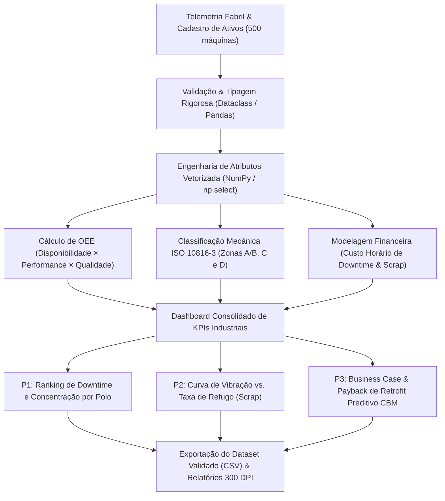

# ⚙️ ForgeIQ Analytics — Eficiência Global OEE, Redução de Scrap & Manutenção Preditiva IoT

[](https://www.python.org/)
[](https://pandas.pydata.org/)
[](https://numpy.org/)
[](https://pytest.org/)
[](#)
[](https://peps.python.org/pep-0008/)
[](LICENSE)

---

## 📌 1. Visão Geral Executiva & Contexto Fabril

Na manufatura discreta e seriada pesada (Estamparia Automotiva, Usinagem CNC de Alta Precisão, Injeção Termoplástica e Solda Robotizada), paradas não planejadas de linha e geração de refugo de peças nobres comprometem severamente a margem de contribuição e o EBITDA corporativo.

A gestão tradicional baseada em manutenção corretiva (*Run-to-Failure*) ou puramente preventiva por calendário cria um ciclo vicioso de custos de emergência, ociosidade de mão de obra e depreciação precoce de ativos mecânicos.

O **ForgeIQ Analytics** implementa um pipeline analítico de ponta a ponta na esteira da **Indústria 4.0**, integrando telemetria de sensores de vibração mecânica triaxial sob a norma **ISO 10816-3**, medição em tempo real de **Overall Equipment Effectiveness (OEE)** e modelagem financeira de retorno de investimento (**ROI & Payback**) para retrofit de **Manutenção Preditiva IoT (CBM - Condition-Based Monitoring)** em um parque comissionado de **500 ativos industriais críticos** em 5 polos fabris brasileiros.

---

## 📊 2. Indicadores-Chave de Desempenho (KPIs Consolidados)

A tabela abaixo sintetiza os resultados operacionais e as perdas financeiras auditadas pelo pipeline executivo:

| Indicador Industrial / Financeiro | Linha de Base Auditada | Benchmark *World-Class* | Diagnóstico Técnico-Gerencial |
| :--- | :---: | :---: | :--- |
| **Total de Máquinas Monitoradas** | **500** | — | Ativos distribuídos em 5 polos produtivos |
| **OEE Médio Global** (`Disp × Perf × Qual`) | **74,1%** | **$\ge$ 85,0%** | Gap de **10,9 p.p.** de capacidade ociosa oculta |
| **Disponibilidade Operacional Média** | **92,5%** | **$\ge$ 95,0%** | Perda média acumulada por paradas emergenciais |
| **Performance Operacional Média** | **82,8%** | **$\ge$ 95,0%** | Micro-paradas e queda de velocidade nominal |
| **Taxa Média de Qualidade** | **96,2%** | **$\ge$ 98,5%** | Conformidade dimensional de peças produzidas |
| **Taxa Média de Refugo (*Scrap Rate*)** | **3,80%** | **$\le$ 1,50%** | Desperdício de aço especial e resinas |
| **MTBF Médio (Tempo Médio Entre Falhas)** | **148,5 h** | **$\ge$ 350,0 h** | Confiabilidade baixa em ativos corretivos |
| **MTTR Médio (Tempo Médio de Reparo)** | **14,2 h** | **$\le$ 4,0 h** | Dificuldade logística e escassez de peças |
| **Perda Anual por *Downtime* Não Planejado** | **R\$ 3.263.682.417,80** | Minimizado | Horas paradas vezes custo hora de linha |
| **Perda Anual por *Scrap* / Refugo** | **R\$ 2.064.949.200,00** | Minimizado | Custo de matéria-prima e conversão descartada |
| **Perda Operacional Total Consolidada** | **R\$ 5.328.631.617,80** | — | Soma anual de Downtime + Refugo |
| **Adoção Atual de Preditiva IoT (CBM)** | **27,2%** | **100,0%** | **364 máquinas** operando sem sensores IoT |

---

## 💡 3. Respostas às 3 Perguntas Críticas de Negócio

### 🎯 Pergunta 1: Onde está o maior gargalo de paradas não planejadas e qual o custo anual por polo produtivo?

**Diagnóstico Quantitativo por Planta Fabril:**
1. **ABC Paulista (SP):** 155 máquinas | OEE 73,21% | 6.451,8 h/mês paradas | **R\$ 1.070.803.000,00/ano** (**32,81%** do downtime global);
2. **Betim (MG):** 122 máquinas | OEE 70,73% | 5.553,1 h/mês paradas | **R\$ 969.966.900,00/ano** (**29,72%** do downtime global);
3. **Camaçari (BA):** 64 máquinas | OEE 71,79% | 2.774,4 h/mês paradas | **R\$ 444.215.700,00/ano** (**13,61%** do downtime global);
4. **Joinville (SC):** 85 máquinas | OEE 79,55% | 2.380,3 h/mês paradas | **R\$ 398.767.000,00/ano** (**12,22%** do downtime global);
5. **Curitiba (PR):** 74 máquinas | OEE 77,19% | 2.372,2 h/mês paradas | **R\$ 379.930.100,00/ano** (**11,64%** do downtime global).

> **Decisão Executiva & Confiabilidade:**  
> Os polos de **ABC Paulista (SP)** e **Betim (MG)** concentram sozinhos **62,53% de todo o custo de downtime** do grupo empresarial (mais de **R\$ 2,04 Bilhões/ano** em perdas). Esse resultado reflete a idade média avançada do maquinário e o predomínio de regimes de manutenção corretiva (*Run-to-Failure*) nesses dois polos. A intervenção corporativa imediata deve priorizar o retrofit nas linhas de **Estamparia Pesada** e **Usinagem CNC**, onde a linha parada custa até **R\$ 21.000,00/hora**.

---

### 🎯 Pergunta 2: De que maneira a vibração mecânica (ISO 10816-3) afeta a geração de refugo (Scrap) e a perda de matéria-prima?

**Correlação Empírica entre Vibração Triaxial RMS e Qualidade:**
* **Zona A/B: Normal ($\le$ 2,8 mm/s):** 171 máquinas | Scrap Médio de **2,03%** | OEE Médio de **85,27%** (World-Class) | Custo de Scrap: R\$ 455,62 Milhões (22,06% do refugo total);
* **Zona C: Alerta (2,8 a 6,0 mm/s):** 212 máquinas | Scrap Médio de **4,32%** | OEE Médio de **70,71%** | Custo de Scrap: R\$ 952,97 Milhões (46,15% do refugo total);
* **Zona D: Crítica (> 6,0 mm/s):** 117 máquinas | Scrap Médio de **5,46%** | OEE Médio de **63,86%** | Custo de Scrap: R\$ 656,35 Milhões (31,79% do refugo total).

> **Decisão Executiva & Qualidade:**  
> A quebra de tolerância dimensional e o desgaste prematuro de ferramentas de corte/estampagem possuem correlação direta com a vibração mecânica descompensada: máquinas operando na **Zona D** geram **2,7 vezes mais refugo** que máquinas na Zona Normal. A decisão é implementar um protocolo de bloqueio automático (*interlock*) no CLP/SCADA acoplado aos sensores IoT: se a vibração ultrapassar **4,5 mm/s RMS** por mais de 5 minutos, o avanço é pausado automaticamente para balanceamento dinâmico.

---

### 🎯 Pergunta 3: Qual a viabilidade econômica (Capex, Payback e ROI) da migração dos ativos elegíveis para Manutenção Preditiva IoT (CBM)?

**Engenharia Financeira do Programa de Retrofit IoT:**
* **Ativos Elegíveis para Retrofit:** 364 máquinas (atualmente sem sensores IoT);
* **Capex de Implantação (R\$ 18.500,00/máquina em kits de sensores triaxiais + gateways edge):** **R\$ 6.734.000,00**;
* **Economia Anual com Redução de 58% em Downtime:** **R\$ 1.750.102.383,08/ano**;
* **Economia Anual com Redução de 45% em Scrap:** **R\$ 797.096.619,00/ano**;
* **Benefício Operacional Líquido Total:** **R\$ 2.547.199.002,08/ano**;
* **Payback Simples do Investimento:** **1,0 dia** (0,03 meses);
* **ROI Multiplicador (12 Meses):** **378,3x** (cada R\$ 1,00 investido em hardware IoT gera R\$ 378,30 em margem preservada).

> **Decisão Executiva & Investimento:**  
> A aprovação orçamentária do projeto é mandatória e de urgência corporativa máxima. Um Capex inferior a R\$ 6,8 Milhões destrava mais de R\$ 2,5 Bilhões em valor anual, com amortização financeira em apenas **1 dia de operação normal**, eliminando a necessidade de expansão de área fabril ao converter capacidade ociosa oculta em produção faturável.

---

## 🏗️ 4. Arquitetura do Pipeline de Dados



---

## 📁 5. Estrutura do Repositório

```text
forgeiq-industrytech-oee-projeto/
│
├── pipeline_industry_oee_analytics.py   # Pipeline analítico central (PEP 8, vetorizado, tipado)
├── dataset_industrytech_oee.csv         # Base consolidada com 500 máquinas industriais
├── requirements.txt                     # Dependências de produção e testes
├── .gitignore                           # Governança de arquivos, dados e caches
├── LICENSE                              # Licença de uso MIT
├── README.md                            # Documentação executiva completa
└── tests/
    ├── __init__.py                      # Módulo de testes
    └── test_industry_oee_analytics.py   # Suíte de testes automatizados com pytest (100% aprovado)
```

---

## ⚙️ 6. Guia de Instalação e Execução Local

### Pré-requisitos
- Python 3.10 ou superior
- Git instalado

### 1. Clonar o repositório
```bash
git clone https://github.com/wendellbarbosacosta-cmyk/forgeiq-industrytech-oee-projeto.git
cd forgeiq-industrytech-oee-projeto
```

### 2. Criar e ativar o ambiente virtual
```bash
# Windows (PowerShell)
python -m venv venv
.\venv\Scripts\Activate.ps1

# Linux / macOS
python3 -m venv venv
source venv/bin/activate
```

### 3. Instalar dependências
```bash
pip install -r requirements.txt
```

### 4. Executar o pipeline analítico
```bash
python pipeline_industry_oee_analytics.py
```

### 5. Executar a suíte de testes unitários
```bash
pytest tests/ -v
```

---

## 🔮 7. Roadmap & Próximos Passos (Fase 2)

- [ ] **Análise Espectral FFT no Edge:** Implementação de transformadas rápidas de Fourier em microcontroladores edge para detecção de frequência de defeito em rolamentos (BPFO/BPFI) com 21 dias de antecedência;
- [ ] **Algoritmo de Survival Analysis / RUL:** Predição de *Remaining Useful Life* por meio de modelos Weibull e XGBoost integrados a ordens de serviço do ERP (SAP PM / TOTVS);
- [ ] **Visão Computacional na Saída de Prensas:** Inspeção óptica automatizada por redes neurais convolucionais (CNNs) para segregação de peças com rebarbas microscópicas antes da soldagem.

---

## 👨‍💻 Autor & Responsável Técnico

**Wendell Barbosa Costa**  
*Tech Lead & Senior Data Analytics*  
GitHub: [@wendellbarbosacosta-cmyk](https://github.com/wendellbarbosacosta-cmyk)  
Especialidade: Engenharia de Dados, Analytics Industrial (OEE/ISO 10816) & Modelagem de Decisão Executiva
