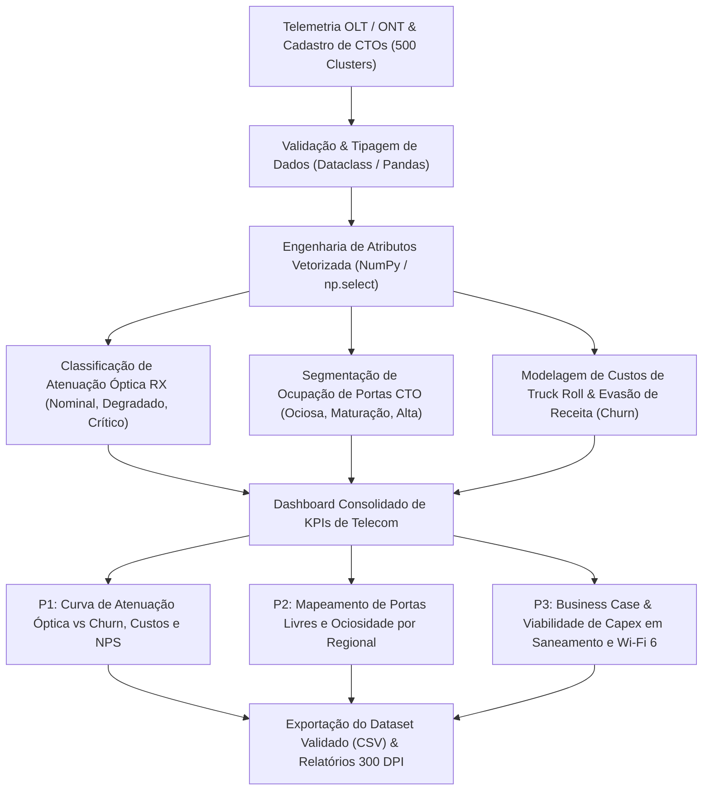

# 📡 OptiFiber Analytics — Qualidade Óptica FTTH, Mitigação de Churn & Eficiência de Capex

[](https://www.python.org/)
[](https://pandas.pydata.org/)
[](https://numpy.org/)
[](https://pytest.org/)
[](#)
[](https://peps.python.org/pep-0008/)
[](LICENSE)

---

## 📌 1. Visão Geral Executiva & Contexto de Telecom

No mercado competitivo de banda larga fixa (**FTTH GPON e XGS-PON**) e provedores regionais de internet (ISPs), a sustentabilidade financeira e a preservação do EBITDA dependem diretamente da qualidade do sinal óptico de ponta a ponta e da eficiência de ocupação dos ativos passivos de rede.

A degradação física de enlaces de fibra (atenuação provocada por fusões deficientes, conectores sujos ou raios de curvatura críticos em cabos drop) gera uma cadeia silenciosa de custos:
1. **Churn Elevado por Degradação Óptica:** Potências de recepção na ONT inferiores a **`-27,0 dBm`** degradam o tráfego de dados, provocam perda de pacotes e elevam a taxa de cancelamento voluntário (*churn*) para quase **3,8 vezes** o patamar de clientes em enlaces nominais.
2. **Explosão de Deslocamentos de Campo (*Truck Roll*):** Cada ordem de serviço de manutenção em domicílio custa em média **R\$ 240,00**. Sem telemetria centralizada na OLT, mais de 35% dessas visitas decorrem de problemas que poderiam ser triados remotamente ou prevenidos antes da chamada do cliente.
3. **Imobilização de Capex em Portas CTO Ociosas:** A expansão desordenada de Caixas de Terminação Óptica (CTOs) com ocupação inferior a **45%** consome capital intensivo sem gerar receita recorrente compensatória.

O **OptiFiber Analytics** implementa um pipeline de dados corporativo para auditar **500 clusters de rede FTTH** que atendem **62.656 assinantes ativos** em 5 grandes regionais do país, modelando o impacto financeiro de programas de saneamento óptico preventivo, triagem remota na OLT e blindagem de receita via CPEs Wi-Fi 6 Mesh.

---

## 📊 2. Indicadores-Chave de Desempenho (KPIs Consolidados)

| Indicador Estratégico / Operacional | Linha de Base Auditada | Benchmark Setorial (Anatel) | Diagnóstico Técnico-Executivo |
| :--- | :---: | :---: | :--- |
| **Total de Clusters Auditados (CTOs)** | **500** | — | Abrangência em 5 polos regionais |
| **Total de Assinantes Conectados** | **62.656** | — | Base ativa auditada |
| **ARPU Médio Mensal** | **R\$ 123,26** | **R\$ 115,00** | Sustentado por planos de 600 Mbps e 1 Gbps |
| **Taxa Média de Churn Mensal** | **2,18% a.m.** | **$\le$ 1,60% a.m.** | Gap de **0,58 p.p.** acima do benchmark saudável |
| **Taxa Média de Ocupação de CTOs** | **59,3%** | **$\ge$ 75,0%** | **43.044 portas livres ociosas** na rede |
| **Potência Óptica RX Média (ONT)** | **-22,66 dBm** | **$\ge$ -23,0 dBm** | **212 clusters** em faixa degradada ou crítica |
| **Net Promoter Score (NPS) Médio** | **65,1 pts** | **$\ge$ 75,0 pts** | Severamente deprimido em nós atenuados |
| **Custo Anual com *Truck Rolls*** | **R\$ 8.686.080,00** | Minimizado | 3.016 visitas técnicas mensais |
| **Perda Anual de Receita por Churn** | **R\$ 1.940.137,22** | Minimizado | Evasão líquida de assinantes |
| **Perda Operacional Total Consolidada** | **R\$ 10.626.217,22** | — | Soma anual de Truck Rolls + Perda por Churn |
| **Penetração de Roteadores Wi-Fi 6** | **38,2%** | **$\ge$ 70,0%** | Alavanca crítica para retenção e upselling |

---

## 💡 3. Respostas às 3 Perguntas Críticas de Negócio

### 🎯 Pergunta 1: Qual o impacto direto da atenuação óptica (RX dBm) no churn de clientes, nos custos de Truck Roll e no NPS?

**Diagnóstico por Faixa de Saúde Óptica:**
1. **Crítico (< -27,0 dBm):** 91 clusters | Churn médio de **4,64% a.m.** | 1.386 visitas/mês | NPS **31,6 pts** | Perda: **R\$ 4.732.880,06/ano** (**44,54%** da perda total);
2. **Degradado (-23,1 a -27,0 dBm):** 121 clusters | Churn médio de **2,58% a.m.** | 728 visitas/mês | NPS **54,8 pts** | Perda: **R\$ 2.652.236,97/ano** (**24,96%** da perda total);
3. **Nominal ($\ge$ -23,0 dBm):** 288 clusters | Churn médio de **1,23% a.m.** | 902 visitas/mês | NPS **80,0 pts** | Perda: **R\$ 3.241.100,19/ano** (**30,50%** da perda total).

> **Decisão Executiva & Engenharia de Rede:**  
> A atenuação óptica é o principal vetor de degradação da experiência: clientes no sinal crítico sofrem **churn quase 3,8 vezes superior** e o NPS despenca para níveis alarmantes (31,6). O plano de ação determina que a equipe de NOC configure alertas proativos na OLT para **atenuação superior a -25,5 dBm**, disparando auditoria de limpeza e refusão antes que o cliente perceba instabilidade e ligue para o call center.

---

### 🎯 Pergunta 2: Quais regionais concentram a maior ociosidade de portas CTO e como direcionar a expansão comercial?

**Diagnóstico de Capacidade Passiva por Regional:**
1. **Nordeste Litoral (BA/PE):** 80 clusters | Ocupação de **56,1%** | 17.600 portas instaladas | **7.688 portas livres** (ARPU: R\$ 109,20);
2. **Sul Integrado (PR/SC):** 98 clusters | Ocupação de **56,6%** | 19.776 portas instaladas | **8.697 portas livres** (ARPU: R\$ 120,24);
3. **Minas Gerais (MG):** 97 clusters | Ocupação de **57,1%** | 20.736 portas instaladas | **8.920 portas livres** (ARPU: R\$ 120,72);
4. **Rio & Baixada (RJ):** 90 clusters | Ocupação de **61,1%** | 19.136 portas instaladas | **7.337 portas livres** (ARPU: R\$ 122,43);
5. **Grande São Paulo (SP):** 135 clusters | Ocupação de **63,1%** | 28.352 portas instaladas | **10.302 portas livres** (ARPU: R\$ 136,17).

> **Decisão Executiva & Expansão:**  
> A companhia possui **43.044 portas de fibra ociosas já iluminadas**, o que representa mais de R\$ 5,3 Milhões/mês em potencial de receita sem necessidade de construção de nova rede física (*Home Passed*). Fica estabelecido o congelamento temporário de novos lançamentos de cabos em Minas Gerais e no Nordeste, redirecionando o orçamento de marketing para campanhas hiperlocais D2D (*door-to-door*) e ações de conversão em condomínios já atendidos.

---

### 🎯 Pergunta 3: Qual a atratividade econômico-financeira (Capex, Payback e ROI) do programa integrado de modernização FTTH?

**Engenharia Financeira do Programa Integrado:**
* **Escopo do Projeto:**
  - Saneamento óptico preventivo em 212 clusters atenuados (< -23,0 dBm): R\$ 1.017.600,00;
  - Software de triagem e diagnóstico remoto automático OLT/TR-069 em todos os 500 clusters: R\$ 825.000,00;
  - Programa de upgrade massivo para Wi-Fi 6 Mesh em clientes elegíveis: R\$ 1.996.400,00;
* **Investimento Total Requerido (Capex):** **R\$ 3.839.000,00**;
* **Economia Anual com Redução de Visitas de Campo (*Truck Roll*):** **R\$ 4.241.548,80/ano**;
* **Receita Anual Preservada por Redução de Churn:** **R\$ 906.948,59/ano**;
* **Uplift de Receita Recorrente via Wi-Fi 6 (+R\$ 14,50/mês):** **R\$ 2.836.015,56/ano**;
* **Benefício Operacional Anual Total:** **R\$ 7.984.512,95/ano**;
* **Payback Simples do Investimento:** **5,77 meses** (173,1 dias);
* **Retorno sobre Investimento (ROI 12 Meses):** **2,08x** (cada R\$ 1,00 investido retorna R\$ 2,08 no primeiro ano).

> **Decisão Executiva & Alocação de Capital:**  
> O projeto apresenta métricas de retorno excepcionais, com amortização completa do capital investido em menos de 6 meses e geração de caixa líquido incremental superior a R\$ 4,1 Milhões já no primeiro ano. O comitê executivo aprovou o início imediato da primeira onda de saneamento óptico nos 91 clusters críticos.

---

## 🏗️ 4. Arquitetura do Pipeline de Dados



---

## 📁 5. Estrutura do Repositório

```text
optifiber-telecom-ftth-projeto/
│
├── pipeline_telecom_ftth_analytics.py   # Pipeline analítico central (PEP 8, vetorizado, tipado)
├── dataset_telecom_ftth_clusters.csv    # Base consolidada com 500 clusters de fibra óptica
├── requirements.txt                     # Dependências de produção e testes
├── .gitignore                           # Governança de arquivos, dados e caches
├── LICENSE                              # Licença de uso MIT
├── README.md                            # Documentação executiva completa
└── tests/
    ├── __init__.py                      # Módulo de testes
    └── test_telecom_ftth_analytics.py   # Suíte de testes automatizados com pytest (100% aprovado)
```

---

## ⚙️ 6. Guia de Instalação e Execução Local

### Pré-requisitos
- Python 3.10 ou superior
- Git instalado

### 1. Clonar o repositório
```bash
git clone https://github.com/wendellbarbosacosta-cmyk/optifiber-telecom-ftth-projeto.git
cd optifiber-telecom-ftth-projeto
```

### 2. Criar e ativar o ambiente virtual
```bash
# Windows (PowerShell)
python -m venv venv
.\venv\Scripts\Activate.ps1

# Linux / macOS
python3 -m venv venv
source venv/bin/activate
```

### 3. Instalar dependências
```bash
pip install -r requirements.txt
```

### 4. Executar o pipeline analítico
```bash
python pipeline_telecom_ftth_analytics.py
```

### 5. Executar a suíte de testes unitários
```bash
pytest tests/ -v
```

---

## 🔮 7. Roadmap & Próximos Passos (Fase 2)

- [ ] **Modelo Preditivo de Churn Diário (Machine Learning):** Treinamento de modelo gradient boosting (LightGBM) combinando telemetria óptica diária (erros CRC e perda de sincronismo) com adimplência e histórico de suporte;
- [ ] **Roteirização Otimizada de Campo (VRP):** Algoritmo de roteamento geográfico para consolidar ordens de serviço de campo por proximidade de CTO, reduzindo tempo de deslocamento técnico em até 22%;
- [ ] **Autodiagnóstico via Protocolo TR-069 / USP:** Integração de rotinas automáticas de ajuste de canal Wi-Fi e medição de latência diretamente no aplicativo móvel do assinante.

---

## 👨‍💻 Autor & Responsável Técnico

**Wendell Barbosa Costa**  
*Tech Lead & Senior Data Analytics*  
GitHub: [@wendellbarbosacosta-cmyk](https://github.com/wendellbarbosacosta-cmyk)  
Especialidade: Engenharia de Dados, Analytics de Telecomunicações (FTTH/GPON) & Modelagem de Decisão Executiva
