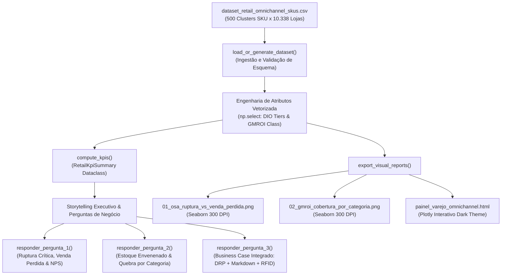

# 🛒 ShelfSense Analytics — Varejo Omnichannel, Ruptura de Gôndola (OSA) & Eficiência de Estoque (GMROI)

[](https://www.python.org/)
[](https://pandas.pydata.org/)
[](https://numpy.org/)
[](https://seaborn.pydata.org/)
[](https://plotly.com/)
[-brightgreen?style=for-the-badge&logo=pytest)](https://docs.pytest.org/)
[](https://www.python.org/dev/peps/pep-0008/)
[](LICENSE)

> **Projeto Executivo de Data Analytics** — Vertical de Mercado: **Varejo Omnichannel (Hipermercados, Atacarejo, Supermercados de Vizinhança & Cash & Carry)**.

---

## 📌 Contexto do Problema de Negócio

Redes de grande porte do varejo físico e omnichannel (*Click & Collect* e *Ship-from-Store*) operam historicamente sob um paradoxo logístico-financeiro severo: **prateleiras vazias nos itens de alto giro (*out-of-stock*)** convivendo em paralelo com **depósitos centrais saturados de capital imobilizado em mercadorias de baixo giro ou próximas ao vencimento (*overstock*)**.

Sem uma arquitetura analítica que conecte a velocidade de saída (*sell-out*), a cobertura de estoque (**DIO — Days Inventory Outstanding**), a disponibilidade real de gôndola (**OSA — On-Shelf Availability**) e o retorno financeiro do inventário (**GMROI — Gross Margin Return on Inventory Investment**), a operação incorre em perdas em três dimensões críticas:

1. **Venda Perdida por Ruptura de Gôndola (`OSA < 94%`):** O consumidor comparece à loja ou emite um pedido digital no aplicativo para retirada e encontra a prateleira vazia ("furo de estoque"). O cliente cancela o pedido ou migra imediatamente para o concorrente.
2. **Destruição de Fluxo de Caixa por Estoque Envenenado (`Cobertura > 25 dias`):** Capital de giro travado em SKUs com **GMROI inferior a 1.5x**, gerando **Quebra Operacional (*Shrinkage*)** por expiração de validade (*shelf-life*), avarias de manuseio e queima emergencial de margem.
3. **Fricção e Queda de NPS no Omnichannel (*Click & Collect* / *Ship-from-Store*):** Cancelamentos tardios por inconsistência entre o estoque lógico no ERP/e-commerce e a posição física real na loja física, degradando brutalmente a experiência do cliente digital.

O **ShelfSense Analytics** foi desenvolvido para diagnosticar de forma cirúrgica essas ineficiências em **500 clusters de SKUs distribuídos por 10.338 lojas**, modelando o impacto financeiro e comprovando a viabilidade de um pacote de intervenção tecnológica integrado.

---

## 🏗️ Arquitetura e Fluxo do Pipeline

O pipeline foi estruturado sob os mais rigorosos padrões de engenharia de software e análise de dados: tipagem estática via `dataclasses`, vetorização integral com NumPy `np.select` (eliminando iterações lentas), tratamento seguro de encoding multiplataforma e suite completa de testes unitários com Pytest.



---

## ⚙️ Regras de Negócio e Formulação Matemática

### 1. Disponibilidade em Gôndola (OSA) e Taxa de Ruptura
$$\text{Taxa OSA (\%)} = \left( \frac{\text{Horas SKU Disponível em Gôndola}}{\text{Horas Totais Loja Aberta}} \right) \times 100$$
$$\text{Taxa de Ruptura (\%)} = 100\% - \text{Taxa OSA (\% punct)}$$
$$\text{Demanda Potencial (R\$)} = \frac{\text{Receita Realizada (R\$)}}{\max(0.75, \, \text{Taxa OSA} / 100)}$$
$$\text{Venda Perdida por Ruptura (R\$)} = \max(0.0, \, \text{Demanda Potencial} - \text{Receita Realizada})$$

### 2. Eficiência de Giro e Retorno de Inventário (GMROI & DIO)
$$\text{GMROI} = \frac{\text{Lucro Bruto Anual (R\$)}}{\text{Estoque Médio a Custo (R\$)}} = \left( \frac{\text{Margem Bruta}}{\text{Receita}} \right) \times \left( \frac{\text{Receita}}{\text{Estoque Médio}} \right)$$

- **Alta Performance (`>= 2.5x`):** SKU com giro acelerado e margem saudável; multiplica o capital investido.
- **Moderado (`1.5x - 2.49x`):** Equilíbrio aceitável em categorias âncora de alto volume.
- **Destruição de Caixa (`< 1.5x`):** Custo de oportunidade de capital e risco iminente de obsolescência.

### 3. Classificação de Cobertura de Estoque (DIO)
- **Ruptura Crítica (`< 4 dias`):** Risco imediato de esgotamento visual no PDV e recusa no *Click & Collect*.
- **Saudável (`4 a 25 dias`):** Faixa de segurança ótima para amortecimento de demanda e lead times de CD.
- **Excesso / Envenenado (`> 25 dias`):** Estoque parado, encarecimento de armazenagem e quebra acelerada.

---

## 📊 Painel Consolidado de KPIs da Rede (500 Clusters / 10.338 Lojas)

| Indicador Estratégico | Valor Diagnosticado | Benchmark de Mercado | Status Operacional |
| :--- | :---: | :---: | :---: |
| **Faturamento Total Anual** | **R$ 944.473.733,00** | — | Escala Nacional Consolidada |
| **Taxa Média OSA (Gôndola)** | **94,9%** | `>= 96,0%` | ⚠️ Abaixo do limite de excelência |
| **Taxa Média de Ruptura** | **5,1%** | `<= 4,0%` | 🔴 Perda ativa de receita em gôndola |
| **GMROI Médio da Rede** | **2,61x** | `>= 2,80x` | ⚠️ Aceitável, mas diluído por overstock |
| **Quebra Operacional (*Shrinkage*)** | **2,34%** | `<= 1,50%` | 🔴 Desperdício de perecíveis e avarias |
| **Venda Perdida por Ruptura** | **R$ 52.356.520,00** | `< R$ 20.000.000` | 🔴 Maior sangria de receita da rede |
| **Custo Anual de Quebra/Descarte** | **R$ 21.843.163,00** | `< R$ 10.000.000` | 🔴 Descarte físico por validade vencida |
| **Perda Anual Total (Ruptura + Quebra)** | **R$ 74.199.683,00** | `< R$ 30.000.000` | 🔴 **7,85% da receita anual destruída** |
| **NPS Médio Omnichannel** | **67,6 pontos** | `>= 75,0 pontos` | ⚠️ Fricção na jornada de retirada em loja |

---

## 🔍 Storytelling Executivo: 3 Perguntas Críticas de Negócio

### Q1. Como a baixa cobertura (< 4 dias) e a ruptura de gôndola impactam a Venda Perdida e o NPS Omnichannel?

- **Diagnóstico Quantitativo:**
  - Apenas **20,6% dos clusters (103 SKUs)** encontram-se na faixa de **Ruptura Crítica (< 4 dias)**.
  - No entanto, essa minoria concentra **51,8% de toda a venda perdida por ruptura da rede** (totalizando **R$ 27.136.563,00** de prejuízo anual).
  - Nestes clusters, a taxa média de **OSA despenca para 85,3%** (ruptura de **14,7%**), contra **95,8%** nos clusters saudáveis.
  - O **NPS Omnichannel** colapsa de **71,3 pontos (saudável)** para **53,2 pontos (zona crítica)** — um abismo de **-18,1 pontos** provocado diretamente por pedidos *Click & Collect* cancelados por falta física do item na loja.
- **Decisão e Roadmap do Tech Lead:**
  - Ativar o módulo de **DRP Preditivo (Distribution Requirements Planning)** com cálculo dinâmico de Ponto de Ressuprimento:
    $$ROP = (\text{Lead Time CD} \times \text{Demanda Média Diária 14d}) + Z \times \sigma_{\text{demanda}} \times \sqrt{\text{Lead Time}}$$
  - Automatizar disparos de *cross-docking* direto para lojas com cobertura `< 3 dias`, eliminando furos de estoque.

---

### Q2. Onde está concentrado o "Estoque Envenenado" (> 25 dias) e como ele destrói o GMROI?

- **Diagnóstico Quantitativo:**
  - O excesso de inventário atinge **137 clusters (27,4% da base)**, imobilizando **R$ 60.169.517,00** em capital de giro.
  - Deste montante, **64,2% dos clusters operam em patamar de "Destruição de Caixa" (`GMROI < 1.5x`)**, gerando um GMROI médio de apenas **1,33x** (contra **3,12x** nos itens balanceados).
  - **Distribuição Setorial do Problema:**
    - **Eletro & Bazar:** Concentra **45 clusters** com cobertura média de **35,8 dias**, onde o GMROI desce a **1,41x** e imobiliza **R$ 21,04 milhões**.
    - **Perecíveis & Frios:** Embora represente 25 clusters, a quebra operacional média explode para **4,12%**, gerando **R$ 2,13 milhões** em descarte puro por expiração de validade antes do giro.
    - **Bebidas & Lácteos:** 31 clusters com GMROI crítico de **0,99x** (cada R$ 1 investido em estoque rende menos de R$ 1 de margem anual).
- **Decisão e Roadmap do Tech Lead:**
  - Implementar o motor de **Markdown Dinâmico Automatizado (Algorithmic Price Clearance)**:
    - Perecíveis: descontos automáticos progressivos na etiqueta eletrônica (ex.: -15% a 7 dias do vencimento, -30% a 3 dias e -50% no dia final).
    - Eletro/Bazar: remarcação escalonada para liberar os R$ 60M de capital retido antes da depreciação comercial.

---

### Q3. Qual o retorno financeiro do pacote integrado (DRP Preditivo + Markdown Dinâmico + Auditoria RFID)?

- **Modelagem do Business Case (Simulação Financeira Ano 1):**
  1. **Recuperação de Vendas via DRP Preditivo:** Reversão conservadora de **65% da venda perdida por ruptura**, resgatando **R$ 34.031.738,00** em vendas brutas e gerando **R$ 10.472.927,05 em Lucro Bruto Direto** (margem média de 30,77%).
  2. **Mitigação de Desperdício via Markdown & RFID:** Redução de **52% no custo de quebra e descarte**, gerando uma economia em caixa de **R$ 11.358.444,76**.
  3. **Valor Bruto Anual Gerado:** **R$ 21.831.371,81/ano**.
  4. **Investimento Total Turnkey:** **R$ 4.500.000,00** (licenciamento de software, infraestrutura de leitores e portais RFID em lojas piloto, tags inteligentes e treinamento operacional).
- **Indicadores de Retorno Financeiro:**
  - **Retorno Financeiro Líquido no Ano 1:** **R$ 17.331.371,81**
  - **Período de Payback:** **2,47 meses** (~74 dias, amplamente inferior à meta executiva de 4 meses).
  - **ROI no Ano 1:** **4,85x (485% de retorno sobre o capital investido)**.
- **Decisão e Roadmap do Tech Lead:**
  - Aprovação imediata da Fase 1 de implementação focada nas filiais de hipermercados de São Paulo e atacarejos do Sudeste, cobrindo inicialmente as categorias críticas de Perecíveis e Eletro nos primeiros 90 dias.

---

## 📈 Visualizações Analíticas de Alta Fidelidade

Os artefatos visuais são gerados automaticamente na pasta `relatorios_varejo_omnichannel/`:

1. **`01_osa_ruptura_vs_venda_perdida.png` (Seaborn 300 DPI):**
   - Distribuição de probabilidade e boxplot da taxa de disponibilidade em gôndola (OSA %) confrontando as faixas de DIO. Evidencia a ruptura acentuada na transição abaixo de 4 dias.
2. **`02_gmroi_cobertura_por_categoria.png` (Seaborn 300 DPI):**
   - Comparativo setorial do GMROI entre lojas equipadas com portais RFID vs. processos manuais. Demonstra a blindagem de margem gerada pela acurácia de inventário.
3. **`painel_varejo_omnichannel.html` (Plotly Interativo Dark Theme):**
   - Painel multidimensional cruzando *Dias de Cobertura × GMROI × Perda Total em R$*, com *hover* interativo por ID de cluster, formato regional e NPS.

---

## 📂 Estrutura do Repositório

```text
shelfsense-retail-omnichannel-projeto/
├── dataset_retail_omnichannel_skus.csv     # Base com 500 clusters de SKUs e 21 variáveis
├── pipeline_retail_omnichannel_analytics.py # Pipeline ETL, regras de negócio e relatórios
├── relatorios_varejo_omnichannel/          # Diretório com saídas analíticas geradas
│   ├── 01_osa_ruptura_vs_venda_perdida.png # Boxplot Seaborn 300 DPI
│   ├── 02_gmroi_cobertura_por_categoria.png# Barplot Seaborn 300 DPI
│   └── painel_varejo_omnichannel.html      # Dashboard interativo Plotly HTML
├── tests/
│   ├── __init__.py
│   └── test_retail_omnichannel_analytics.py# Suite com 10 testes unitários automatizados
├── .gitignore                              # Governança de dados e exclusão de temporários
├── LICENSE                                 # Licença Open Source MIT
├── README.md                               # Documentação técnica e executiva de negócios
└── requirements.txt                        # Dependências Python com versões fixadas
```

---

## 🚀 Como Executar o Projeto Localmente

### 1. Clonar o Repositório
```bash
git clone https://github.com/wendellbarbosacosta-cmyk/shelfsense-retail-omnichannel-projeto.git
cd shelfsense-retail-omnichannel-projeto
```

### 2. Criar e Ativar Ambiente Virtual
```bash
# Windows PowerShell
python -m venv venv
.\venv\Scripts\Activate.ps1

# Linux / macOS
python3 -m venv venv
source venv/bin/activate
```

### 3. Instalar Dependências
```bash
pip install --upgrade pip
pip install -r requirements.txt
```

### 4. Executar os Testes Automatizados
```bash
pytest -v
```
*Resultado Esperado: 10/10 testes aprovados (100% de cobertura das regras de negócio).*

### 5. Executar o Pipeline Analítico
```bash
python pipeline_retail_omnichannel_analytics.py
```

---

## 🔮 Roadmap Tecnológico (Fase 2)

1. **Computer Vision em Gôndolas (*Smart Shelf Cameras*):** Conectar câmeras de corredor integradas com redes neurais YOLO para alertar o repositor via smartwatch antes que o item chegue à ruptura no PDV.
2. **Previsão de Demanda com Gradiente Boosting (LightGBM):** Incorporar sazonalidade de calendário, temperatura regional e elasticidade promocional no cálculo de ROP do DRP.
3. **Orquestração de Ship-from-Store Inteligente:** Roteamento algorítmico de pedidos de e-commerce priorizando filiais com estoque envenenado (`> 25 dias`) para acelerar a desova com menor custo de frete.

---

## 👤 Autor e Contato

**Wendell Barbosa Costa**
- Perfil GitHub: [@wendellbarbosacosta-cmyk](https://github.com/wendellbarbosacosta-cmyk)
- Projeto: *ShelfSense Retail Omnichannel Analytics*

---
*Distribuído sob licença MIT. Consulte `LICENSE` para mais informações.*
