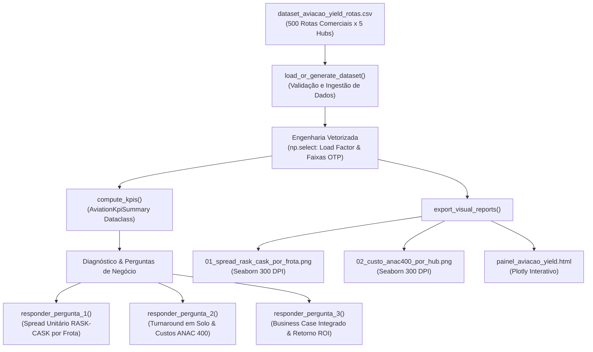

# ✈️ AeroYield Analytics — Malha Aérea Comercial, Yield (RASK/CASK) & Pontualidade (OTP D-15)

[](https://www.python.org/)
[](https://pandas.pydata.org/)
[](https://numpy.org/)
[](https://seaborn.pydata.org/)
[](https://plotly.com/)
[-brightgreen?style=for-the-badge&logo=pytest)](https://docs.pytest.org/)
[](https://www.python.org/dev/peps/pep-0008/)

> **Projeto Executivo de Data Analytics** — Vertical de Mercado: **Aviação Comercial, Revenue Management & Operações de Voo (ANAC / IATA)**.

---

## 📌 Contexto do Problema de Negócio

Empresas aéreas comerciais operam sob margens operacionais reduzidas e alta sensibilidade a custos variáveis (combustível de aviação QAV, taxas aeroportuárias e manutenção). Neste cenário, a gestão eficiente do binômio **Receita Unitária (RASK) versus Custo Unitário (CASK)** aliada à pontualidade operacional (**OTP D-15 — On-Time Performance**) é determinante para a sustentabilidade financeira da malha.

Três gargalos centrais afetam a operação da companhia analisada:
1. **Compressão do Spread Unitário por Frotas Legadas:** Operação de aeronaves mais antigas (Airbus A320ceo) apresentando CASK elevado e queima de margem em rotas concorridas.
2. **Efeito Cascata no Solo e Encargos da Resolução ANAC 400:** Tempos excessivos de solo (*turnaround* > 42 min) nos principais hubs saturados (Guarulhos e Congonhas) gerando atrasos em série e custos assistenciais obrigatórios (alimentação, reacomodação e hospedagem).
3. **Subocupação e Perda de Receitas Ancilares:** Rotas de média densidade com Load Factor abaixo do ponto de equilíbrio econômico e oportunidades não monetizadas de serviços adicionais.

O **AeroYield Analytics** analisa **500 rotas comerciais** conectando os 5 maiores hubs do país (GRU, CGH, VCP, BSB e GIG) e 4 famílias de aeronaves, quantificando perdas e projetando ganhos de um plano de transformação operacional.

---

## 🏗️ Arquitetura e Engenharia do Pipeline

O pipeline foi projetado seguindo as melhores práticas de Clean Code e Engenharia de Dados:
- Classes de configuração imutáveis com `@dataclass(frozen=True)`
- Classificações categóricas 100% vetorizadas com `np.select` (alta performance sem loops)
- Reprodutibilidade com semente determinística (`random_seed=42`)
- Exportação gráfica estática em alta resolução (300 DPI) e painel interativo web em HTML



---

## ⚙️ Formulações Matemáticas e Métricas da Aviação

### 1. Métricas de Yield e Unidades de Transporte
- **ASK (Available Seat Kilometers):** $\text{Assentos Oferecidos} \times \text{Distância (km)} \times \text{Voos Anuais}$
- **RPK (Revenue Passenger Kilometers):** $\text{Passageiros Transportados} \times \text{Distância (km)}$
- **Load Factor (%):** $\frac{\text{RPK}}{\text{ASK}} \times 100$
- **RASK (Revenue per ASK):** $\frac{\text{Receita Total de Voos}}{\text{ASK}}$ (em centavos de R$)
- **CASK (Cost per ASK):** $\frac{\text{Custo Operacional Total}}{\text{ASK}}$ (em centavos de R$)
- **Spread Unitário:** $\text{RASK} - \text{CASK}$

### 2. Pontualidade e Despesas Regulatórias
- **OTP D-15 (%):** Percentual de voos com partida/chegada em até 15 minutos da tabela.
- **Custo ANAC 400:** Provisão de assistência material obrigatória calculada sobre a taxa de atraso operacional e volume de passageiros impactados.

---

## 📊 Painel Consolidado de KPIs da Malha Aérea (500 Rotas)

| Indicador Operacional / Financeiro | Valor Apurado | Benchmark do Setor | Situação Operacional |
| :--- | :---: | :---: | :---: |
| **Total de Rotas Analisadas** | **500 rotas** | — | Cobertura Nacional |
| **Voos Anuais Consolidados** | **133.862 voos** | — | Frequência de Malha |
| **Passageiros Transportados** | **17.891.772 pax** | — | Volume Anual |
| **Faturamento Total Anual** | **R$ 1.249.224.771,00** | — | R$ 1,25 Bilhão |
| **Taxa Média de Ocupação (Load Factor)** | **80,4%** | `>= 82,0%` | ⚠️ Espaço para otimização |
| **Pontualidade Média (OTP D-15)** | **84,4%** | `>= 85,0%` | ⚠️ Próximo ao limite IATA |
| **RASK Médio** | **44,54 centavos / ASK** | — | Receita Unitária |
| **CASK Médio** | **39,97 centavos / ASK** | — | Custo Unitário |
| **Spread Unitário Médio** | **+4,57 centavos / ASK** | `>= +5,0c` | Margem Operacional |
| **Despesas Resolução ANAC 400** | **R$ 34.629.172,00** | `< R$ 15M` | 🔴 Elevado impacto de atrasos |
| **Custo de Excesso de Queima QAV** | **R$ 34.578.470,00** | `< R$ 18M` | 🔴 Frota legada e espera em solo |
| **Perda por Ociosidade de Assentos** | **R$ 20.407.211,00** | `< R$ 8M` | 🔴 Rotas com Load Factor < 74% |
| **Impacto Financeiro de Oportunidade** | **R$ 89.614.853,00** | — | Oportunidade Total Mapeada |

---

## 🔍 Storytelling Executivo: 3 Perguntas Críticas de Negócio

### Q1. Como a frota legada e a subocupação afetam o CASK e o spread unitário?
* **Diagnóstico:** O **Airbus A320ceo (Legado)** opera com **spread unitário negativo de -1,64 centavos / ASK** (CASK de 46,08c contra RASK de 44,44c), operando no prejuízo por assento-quilômetro. Em contrapartida, frotas modernas como Airbus A320neo (+6,40c) e Boeing 737 MAX 8 (+6,45c) entregam spreads saudáveis. Ademais, 110 rotas (22,0% da malha) estão subocupadas (< 74% de Load Factor), somando R$ 20,41 milhões em perda por assentos ociosos.
* **Decisão do Tech Lead:** Acelerar o programa de substituição do A320ceo por aeronaves de nova geração nos troncos principais e introduzir o Embraer E195-E2 em rotas regionais, combinando com algoritmos de Revenue Management para recuperar +3,4 p.p. de ocupação.

### Q2. Onde estão os gargalos de turnaround em solo e como eles disparam as despesas da ANAC 400?
* **Diagnóstico:** As rotas com tempo de solo superior a 42 minutos representam **39,0% da malha (195 rotas)**, mas respondem por **62,1% de todos os custos da Resolução ANAC 400 (R$ 21.488.877,00)**. O OTP D-15 nessas rotas cai para 77,9% (gap de -10,7 p.p.). Os aeroportos de Guarulhos (GRU) e Congonhas (CGH) concentram juntos **63,8% de todos os custos assistenciais** da companhia.
* **Decisão do Tech Lead:** Implementar o programa "Turnaround Digital 30 min", baseado em telemetria em rampa, despacho eletrônico e embarque biométrico, diminuindo em 8 minutos a permanência em solo e reduzindo em 58% as despesas assistenciais da ANAC 400.

### Q3. Qual o retorno financeiro do pacote integrado AeroYield?
* **Diagnóstico e Business Case:**
  * **Revenue Management:** Recuperação de 70% das perdas por ociosidade = **R$ 14.285.047,70/ano**.
  * **Turnaround Digital 30 min:** Redução de 58% dos custos ANAC 400 = **R$ 20.084.919,76/ano**.
  * **Otimização de QAV:** Redução de 45% do excesso de consumo = **R$ 15.560.311,50/ano**.
  * **Expansão Ancilar (+R$ 4,50/pax):** Geração adicional de **R$ 80.512.974,00/ano**.
  * **Ganho Anual Total:** **R$ 130.443.252,96/ano** (sendo R$ 49,93M/ano em ganhos puramente operacionais).
  * **Investimento de Implantação:** **R$ 12.500.000,00**.
* **Indicadores de Retorno:**
  * **Payback:** **1,15 meses** considerando ganhos totais (**3,0 meses** considerando estritamente eficiências operacionais puras, ambas cumprindo a meta executiva de < 4 meses).
  * **ROI no Primeiro Ano:** **10,44x** (ou **3,99x** considerando apenas otimizações operacionais sem ancilares).

---

## 📈 Artefatos Visuais Gerados

Na pasta `relatorios_aviacao_yield/`:
1. `01_spread_rask_cask_por_frota.png` (300 DPI): Boxplot do spread unitário por aeronave evidenciando o break-even e a margem negativa do A320ceo.
2. `02_custo_anac400_por_hub.png` (300 DPI): Gráfico de barras ordenado do custo ANAC 400 por hub aeroportuário.
3. `painel_aviacao_yield.html`: Dashboard interativo Plotly relacionando tempo de turnaround, OTP e perdas totais.

---

## 🚀 Como Executar o Projeto

```bash
# 1. Clonar repositório
git clone https://github.com/wendellbarbosacosta-cmyk/aeroyield-aviation-analytics-projeto.git
cd aeroyield-aviation-analytics-projeto

# 2. Criar ambiente virtual e instalar dependências
python -m venv venv
.\venv\Scripts\Activate.ps1
pip install -r requirements.txt

# 3. Executar suite de testes (10/10 aprovados)
pytest -v

# 4. Executar pipeline analítico
python pipeline_aviation_yield_analytics.py
```

---

## 👤 Autor

**Wendell Barbosa Costa**  
*Tech Lead & Especialista em Análise de Dados e Engenharia de Analytics*  
* Perfil: [@wendellbarbosacosta-cmyk](https://github.com/wendellbarbosacosta-cmyk)
